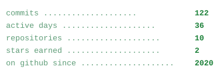

<picture>
  <source media="(prefers-color-scheme: dark)" srcset="assets/banner-dark.svg">
  
</picture>

<picture>
  <source media="(prefers-color-scheme: dark)" srcset="assets/ledger-dark.svg">
  
</picture>

<picture>
  <source media="(prefers-color-scheme: dark)" srcset="assets/commits-dark.svg">
  
</picture>

[mail](mailto:kkaleb-w@users.noreply.github.com) · [github](https://github.com/kkaleb-w)

<!--
  every number is generated from the API, not typed by hand:
      python3 tools/generate_assets.py
-->
