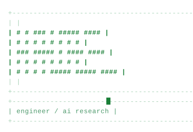
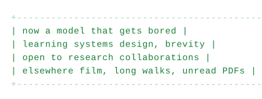

<picture>
  <source media="(prefers-color-scheme: dark)" srcset="assets/banner-dark.svg">
  
</picture>

I write small programs in Python and TypeScript, and keep notes on what breaks.
Most of last year went into one question: what does a model do when nothing is
asking it anything?

<picture>
  <source media="(prefers-color-scheme: dark)" srcset="assets/status-dark.svg">
  
</picture>

<picture>
  <source media="(prefers-color-scheme: dark)" srcset="assets/commits-dark.svg">
  
</picture>

[mail](mailto:kkaleb-w@users.noreply.github.com) · [github](https://github.com/kkaleb-w) · [x](https://x.com/REPLACE) · [linkedin](https://linkedin.com/in/REPLACE)

<!--
  regenerate everything:  python3 tools/generate_assets.py
  name:      NAME   in tools/generate_assets.py
  role line: ROLE   in tools/generate_assets.py
  status:    STATUS in tools/generate_assets.py
-->
